# Angular parity report

Same Playwright specs run against `baseline` (Angular 13, http://localhost:4000) and `upgraded` (http://localhost:4200).
Both apps share one local Django backend, so specs create fresh timestamped data and Playwright `retries: 1` is set.
Volatile regions (map canvas, live clock time, event timeline/counts that grow between runs) are masked in screenshots.

## Flow results

| Page / flow | baseline | upgraded |
| --- | --- | --- |
| auth › Sign in / sign out › protected route redirects to the login form | passed | passed |
| auth › Sign in / sign out › wrong password is rejected and the user stays signed out | passed | passed |
| auth › Sign in / sign out › empty form does not sign in | passed | passed |
| auth › Sign in / sign out › valid credentials sign in, logout signs out | passed | passed |
| clock › clock page shows the live clock and four timers | passed | passed |
| navigation › Shell navigation and theme › side nav lists pages and navigates to Clock | passed | passed |
| navigation › Shell navigation and theme › theme toggle switches dark/light and back | passed | passed |
| operator › Operator page › shows the selected trial and its status chips | passed | passed |
| operator › Operator page › map switcher toggles between the 2D map and the 3D Cesium globe | passed | passed |
| operator › Operator page › tools panel lists every event type under Create, Filter and View tabs | passed | passed |
| operator › Operator page › create an event, add, edit and delete a note on it | passed | passed |
| trial › Trial header › edit-trial form shows the selected trial and cancels without saving | passed | passed |
| trial › Trial header › add menu offers new Day / Shift / Attempt and trial list is selectable | passed | passed |

Totals: baseline 13 passed / 0 failed; upgraded 13 passed / 0 failed.

## Screenshots (baseline left, upgraded right)

| Page | Pixel diff | Size (baseline / upgraded) |
| --- | --- | --- |
| [01-login.png](side-by-side/01-login.png) | 2.94% | 1440x900 / 1440x900 |
| [02-operator.png](side-by-side/02-operator.png) | 3.03% | 1440x900 / 1440x900 |
| [02b-operator-3d.png](side-by-side/02b-operator-3d.png) | 3.75% | 1440x900 / 1440x900 |
| [03-operator-tools.png](side-by-side/03-operator-tools.png) | 4.16% | 1440x900 / 1440x900 |
| [03b-operator-filter.png](side-by-side/03b-operator-filter.png) | 5.25% | 1440x900 / 1440x900 |
| [04-event-dialog.png](side-by-side/04-event-dialog.png) | 75.65% | 1440x900 / 1440x900 |
| [05-sidenav.png](side-by-side/05-sidenav.png) | 31.47% | 1440x900 / 1440x900 |
| [06-login-light-theme.png](side-by-side/06-login-light-theme.png) | 1.68% | 1440x900 / 1440x900 |
| [07-clock.png](side-by-side/07-clock.png) | 9.69% | 1440x900 / 1440x900 |
| [08-trial-edit.png](side-by-side/08-trial-edit.png) | 81.74% | 1440x900 / 1440x900 |
| [09-trial-list.png](side-by-side/09-trial-list.png) | 5.77% | 1440x900 / 1440x900 |

### 01-login.png

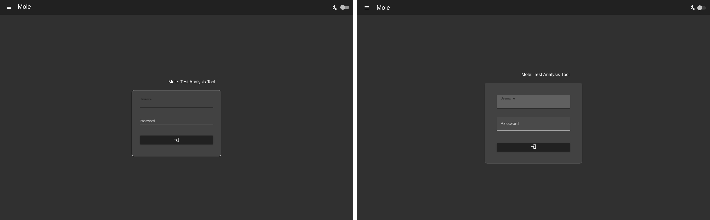

### 02-operator.png

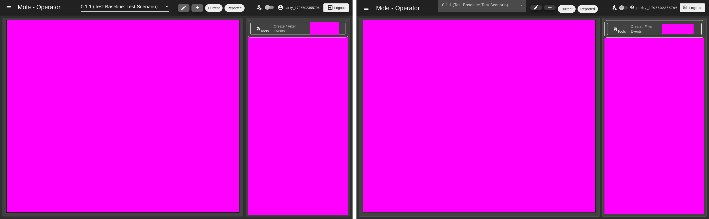

### 02b-operator-3d.png

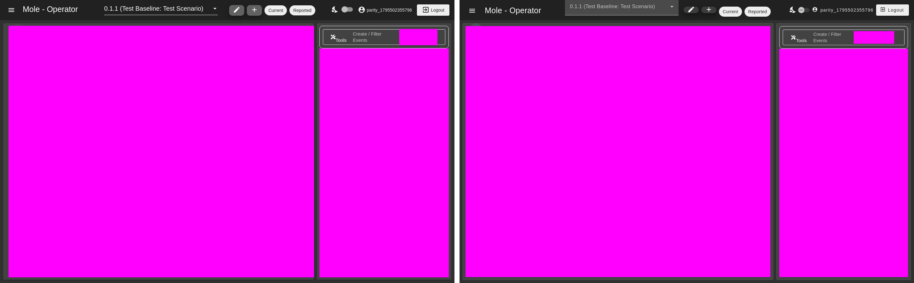

### 03-operator-tools.png

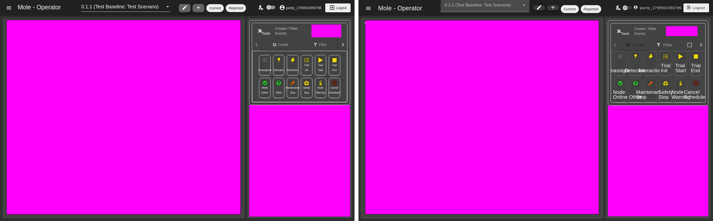

### 03b-operator-filter.png

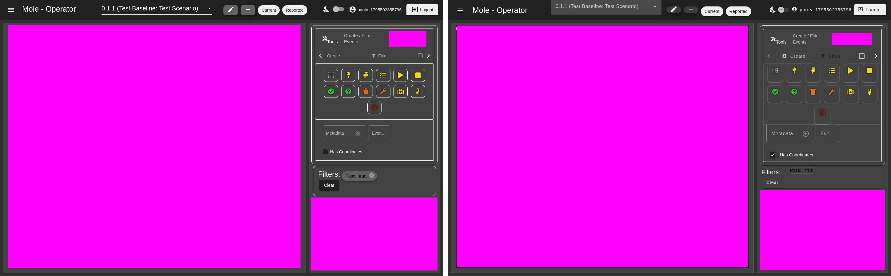

### 04-event-dialog.png

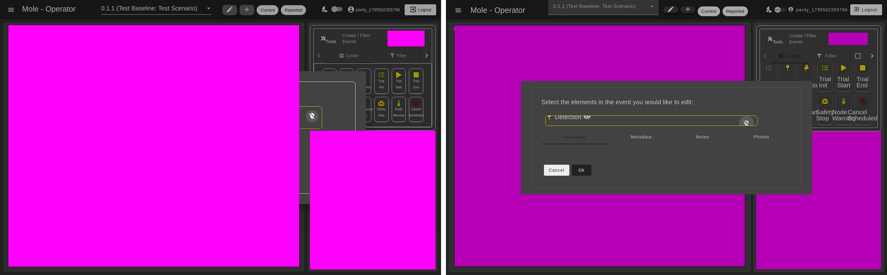

### 05-sidenav.png

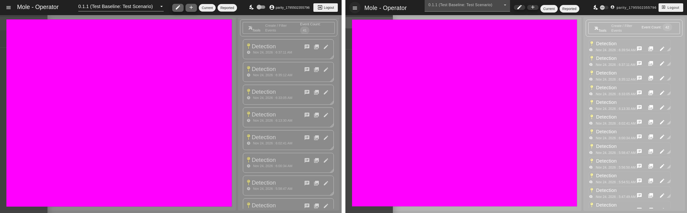

### 06-login-light-theme.png

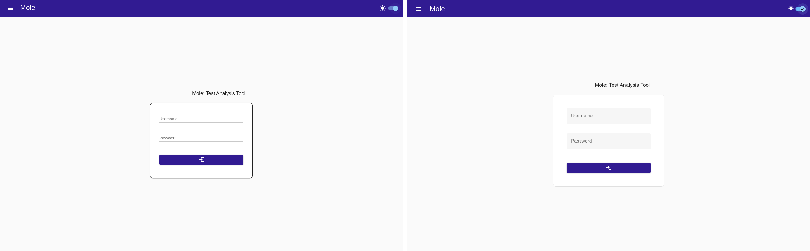

### 07-clock.png

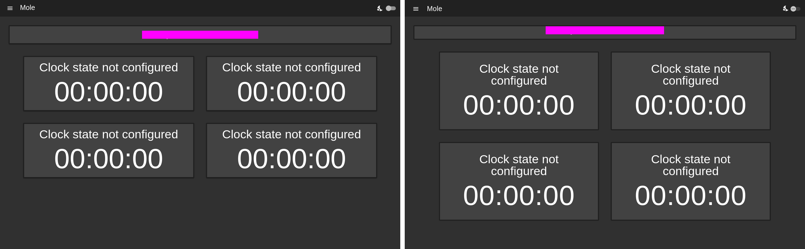

### 08-trial-edit.png

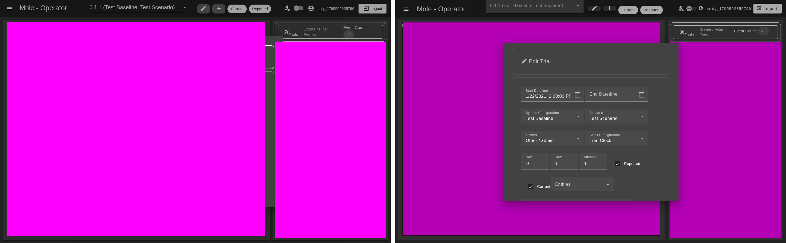

### 09-trial-list.png

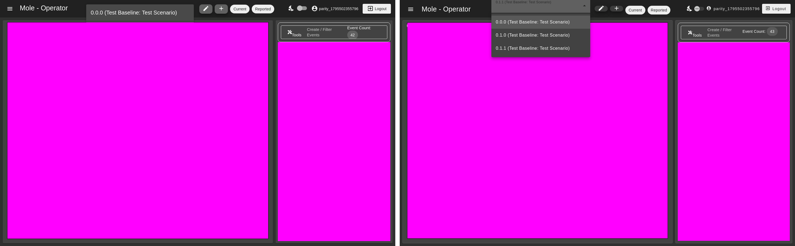
